# Week 8: Native Purchase & Inventory Flow

**Scope:** Odoo 19 Purchase, Inventory, and vendor billing, starting from an RFQ generated by `mini_procurement`.

## Lifecycle at a glance

```mermaid
flowchart LR
    A[Approved Procurement Request] -->|Generate Purchase Order| B[RFQ / Draft purchase.order]
    B -->|Review, negotiate, confirm| C[Confirmed Purchase Order]
    C -->|Purchase Stock integration| D[Incoming Receipt / stock.picking]
    D -->|Record quantities, validate| E[Received quantities updated]
    C -->|Create Bill| F[Draft Vendor Bill / account.move]
    E -. Receipt-based billing quantity .-> F
    F -->|Review and Post| G[Posted Vendor Bill]
```

The receipt and bill branches are related through the purchase order and its lines. A receipt is an inventory operation; a vendor bill is an accounting document. Posting a bill does not validate a receipt, and validating a receipt does not post a bill.

## 1. Create the RFQ

In **Mini Procurement → Operations → Procurement Requests**, create a request with at least one item and submit it. An authorized approver approves it. The request form's **Generate Purchase Order** action then creates a native `purchase.order` in its initial draft/RFQ state, adds `purchase.order.line` records, and links the records through `procurement.request.purchase_order_id` and `purchase.order.procurement_request_id`.

The custom action selects the suggested vendor when present; otherwise it uses the first product's first supplier, the first supplier found, or the company partner as a fallback. It uses the request line's estimated cost (or product standard cost) as the RFQ unit price. It opens the new order for review.

This custom action creates a draft RFQ directly. It does not send the RFQ to the vendor or negotiate/update prices. Those actions happen in the standard Purchase app. The **Procurement** smart button on the PO links back to its request.

## 2. Review and confirm the purchase order

Review the vendor, quantities, UoM, prices, taxes, delivery dates, and other commercial terms on the RFQ. Use Odoo's standard send/print actions if the quotation must be shared with the vendor. When the terms are agreed, click **Confirm Order**.

`mini_procurement` extends `purchase.order.button_confirm()`: after the standard confirmation succeeds, it stamps `approved_by_id` and `date_approved` if they are empty and sets an approval tier based on `amount_total`:

| PO total | Tier |
| --- | --- |
| Less than 5,000 | Tier 1 |
| 5,000 to less than 25,000 | Tier 2 |
| 25,000 or more | Tier 3 |

These custom fields are audit stamps. The custom code does not implement a separate threshold approval gate; any standard approval gate comes from Odoo Purchase configuration and access rights.

## 3. Receive the goods

With the Odoo `purchase_stock` integration installed, confirming a stockable-products PO creates an incoming `stock.picking` linked to the order. Open **Receipt** from the PO, verify the products and quantities physically received, then validate the transfer. Validation updates stock and the PO lines' received quantities. If the delivery is partial, process the backorder prompt to leave the remaining quantity open for a later receipt.

Products configured as services generally do not require an inventory receipt. The available receipt flow depends on the product type, warehouse configuration, routes, and installed stock modules.

`purchase_stock` in this Odoo source tree depends on `stock_account` and `purchase` and is marked `auto_install`. The `mini_procurement` manifest itself declares only `base`, `mail`, and `purchase`; its custom code does not create or validate receipts. Receipt behavior comes from the native stock integration when that integration is installed.

## 4. Create and post the vendor bill

From the PO, use **Create Bill**. Odoo creates a draft vendor bill (`account.move`, `move_type = 'in_invoice'`) linked to the purchase order. Review the vendor invoice number/reference, invoice date, quantities, prices, taxes, and accounts, then post the bill when it is ready for accounting.

The product's **Control Policy / Purchase Method** affects the billable quantity: ordered quantities allow billing against ordered quantity; received quantities make billable quantity depend on recorded receipts. This setting controls quantity eligibility; it does not itself enforce a universal three-way-match approval or automatically post the bill. Any payment and bank reconciliation happens after this document flow.

## Record map

| Business step | Main Odoo record/action | What it records |
| --- | --- | --- |
| Request approval | `procurement.request`, `action_approve` | Internal authorization to source the items |
| RFQ creation | `purchase.order`, `action_create_rfq` | Draft quote linked to the originating request |
| PO confirmation | `purchase.order`, `button_confirm` | Agreed order; custom confirmer, timestamp, and tier |
| Goods receipt | `stock.picking`, validate transfer | Physical quantities received into stock |
| Vendor bill | `account.move`, create from PO then post | Supplier liability and accounting entries |

## Module boundary

`mini_procurement` handles the internal requisition, approval/rejection, estimated total, RFQ creation, request-to-PO links, and PO audit fields. Purchase order confirmation, incoming receipts, vendor bill creation/posting, and accounting entries are Odoo-native behaviors supplied by Purchase and its Inventory/Accounting integrations.
