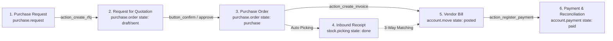

# Native Purchase & Inventory Flow (RFQ → PO → Receipt → Bill)

**Document Version:** 1.0  
**Target Platform:** Odoo 19 (Community & Enterprise)  
**Modules Involved:** `purchase`, `stock` (Inventory), `account` (Invoicing/Accounting), `purchase_request` (Custom Extensions)

---

## 1. Executive Summary & Lifecycle Architecture

The **Procure-to-Pay (P2P)** lifecycle in Odoo tracks the acquisition of goods and services from initial requisition to final vendor payment. The end-to-end pipeline connects four primary business milestones:



---

## 2. Phase-by-Phase Technical Walkthrough

### Phase 1: Request for Quotation (RFQ)
*Initial phase where prices and delivery conditions are negotiated with suppliers.*

* **Primary Model:** `purchase.order`
* **Child Model:** `purchase.order.line`
* **Active State:** `draft` or `sent`
* **Sequence:** Generated automatically using `ir.sequence` (code: `purchase.order`, prefix `P%05d` or `RFQ%05d`).
* **Key Fields & Business Logic:**
  * `partner_id`: Vendor contact record (extended with `tier_level`, `partner_code`, `is_credit_approved`).
  * `order_line`: Products, quantities, unit prices, UoM, and taxes.
  * `date_order`: Expected quotation issuance date.
* **Transitions & Actions:**
  * **Send by Email (`action_rfq_send`):** Prepares an email draft using template `purchase.email_template_edi_purchase` and attaches the Quotation PDF. State advances to `'sent'`.
  * **Print RFQ (`print_quotation`):** Generates a price-hidden RFQ document for physical vendor distribution.

---

### Phase 2: Purchase Order (PO) Confirmation & Approval
*Legally binding agreement confirmed between the company and the supplier.*

* **Active State:** `purchase` (or `'to approve'` if double validation / managerial sign-off is required).
* **Key Methods Triggered:**
  * `button_confirm()`:
    1. Validates analytic distributions and order lines.
    2. Triggers `_create_picking()`: automatically provisions incoming warehouse operations (`stock.picking`).
    3. Custom Module Stamp: Records `approved_by_id`, `date_approved`, and evaluates `approval_tier`.
    4. Switches `state` from `'draft'`/`'sent'` to `'purchase'`.
  * `button_approve()`: Executed by purchase managers when order value exceeds the company threshold.

---

### Phase 3: Warehouse Inbound Receipt (Inventory)
*Physical reception and quality inspection of products at the warehouse dock.*

* **Primary Model:** `stock.picking`
* **Line Items:** `stock.move` & `stock.move.line`
* **Picking Type:** `incoming` (Warehouse In / Inbound)
* **Locations:**
  * **Source Location:** `Locations/Vendors` (`usage = 'supplier'`)
  * **Destination Location:** `WH/Stock` (`usage = 'internal'`)
* **Workflow & Methods:**
  1. Accessible directly from the PO header via the **"Receipt"** Stat Button (`picking_ids`).
  2. Warehouse operators register received quantities into `quantity_done` / `picked`.
  3. **Validate (`button_validate`):**
     * If received quantity equals ordered quantity: `state` moves directly to `'done'`.
     * **Backorder Mechanism:** If partial reception occurs (received < ordered), Odoo prompts a wizard (`stock.backorder.confirmation`). Creating a backorder splits the remaining lines into a secondary pending picking.
* **Automated Stock Valuation & Accounting Impact:**
  * When products use **Automated Inventory Valuation** (AVCO / FIFO):
    * **Debit:** Stock Valuation Account (Asset - `101200 WH/Stock`)
    * **Credit:** Stock Interim Received Account (Clearing - `200000 Stock Interim Received`)

---

### Phase 4: Vendor Bill Creation & 3-Way Matching
*Vendor invoice booking and financial liability recognition.*

* **Primary Model:** `account.move` (`move_type = 'in_invoice'`)
* **Lines Model:** `account.move.line`
* **Control Policy (`product.template.purchase_method`):**
  * **On Ordered Quantities:** Bill can be drafted immediately upon PO confirmation.
  * **On Received Quantities (Standard 3-Way Match):** Bill lines are generated strictly matching `qty_received` verified by warehouse receipts.
* **Workflow & Financial Post:**
  1. Click **"Create Bill"** (`action_create_invoice`) from the PO form.
  2. Review vendor invoice reference (`ref`), invoice date, and bank accounts.
  3. **Post Bill (`action_post`):**
     * **Debit:** Stock Interim Received Account (Clearing account is reconciled to $0.00).
     * **Debit:** Value Added Tax (VAT / Input Tax Account).
     * **Credit:** Accounts Payable (Vendor Liability - `211000 Creditors`).
  4. **Register Payment (`action_register_payment`):**
     * Prompts `account.payment.register` modal.
     * Generates `account.payment`.
     * Status advances to **In Payment** or **Paid** upon bank reconciliation.

---

## 3. Data Flow & Model Cross-Reference

| Stage | Odoo Model | Trigger Button / Method | Related Documents Linked |
| :--- | :--- | :--- | :--- |
| **Requisition** | `purchase.request` | `action_approve()` | Source for PO (`purchase_order_id`) |
| **Quotation** | `purchase.order` | `action_rfq_send()` | `purchase.order.line` |
| **Confirmation** | `purchase.order` | `button_confirm()` | Creates `stock.picking` |
| **Dock Receipt** | `stock.picking` | `button_validate()` | `stock.move`, `stock.move.line` |
| **Vendor Invoice**| `account.move` | `action_post()` | `account.move.line`, Tax Lines |
| **Settlement** | `account.payment` | `action_post()` | Bank Statements & Reconciled Journal Items |

---

## 4. 3-Way Matching Verification Matrix

```
   [Purchase Order]               [Warehouse Receipt]               [Vendor Bill]
+--------------------+         +--------------------+         +--------------------+
| Qty Ordered:  100  |  <===>  | Qty Received: 100  |  <===>  | Qty Billed:   100  |
| Price:     $ 10.00 |         | Discrepancy:    0  |         | Unit Price: $10.00 |
+--------------------+         +--------------------+         +--------------------+
          \                              |                              /
           \                             |                             /
            =========> [All 3 Align: Automated Approval Allowed] <======
```

* **Discrepancy Checks:**
  * **Price Variance:** If `account.move.line.price_unit` > `purchase.order.line.price_unit`, price variance is flagged.
  * **Quantity Variance:** If `qty_billed` > `qty_received`, Odoo highlights the line in red/warning until warehouse logs a backorder or credit note is applied.

---

## 5. Integration with Custom Module (`purchase_request`)

1. **Top-of-Funnel Integration:**
   * Purchase Requests originate in `purchase.request` (`draft` &rarr; `submitted` &rarr; `approved`).
   * On approval, an automated email notification is dispatched (`email_template_purchase_request_approved`).
   * Clicking `action_create_rfq` constructs the native `purchase.order`.
2. **Vendor Profiling:**
   * Partner records display internal code, credit approval flag, and tier (`tier_level`).
3. **Audit Trail & Governance:**
   * PO form incorporates the injected approval panel and tab.
   * Executive sign-offs are logged into the SQL view `purchase.approval.report`.
   * Complete audit histories are exportable via QWeb PDF and Excel XLSX (`purchase.approval.export.wizard`).
